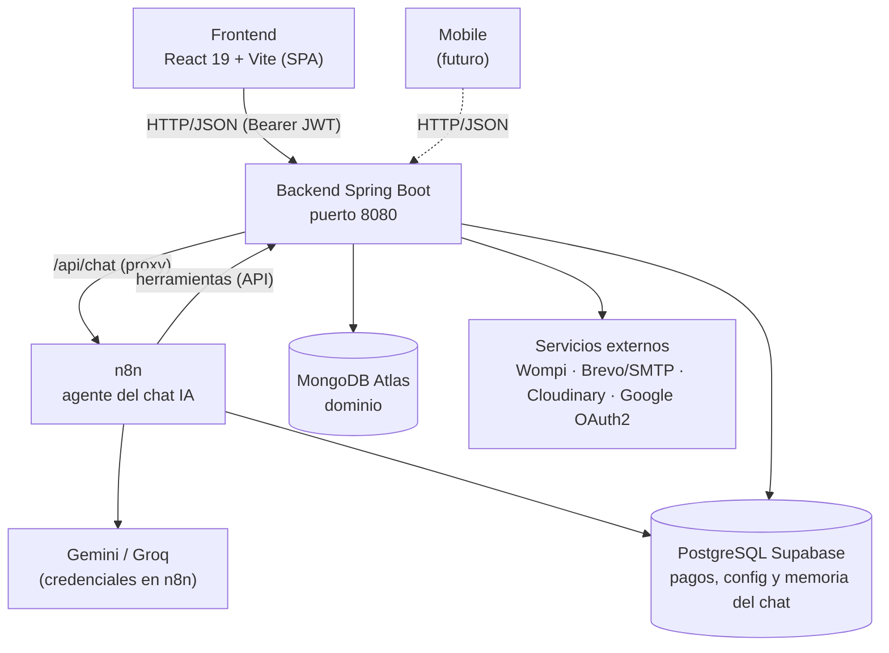

# 🚗 DriveMaster

Plataforma integral de comercio de repuestos automotrices y servicios de taller: catálogo en línea, carrito de compras, pagos con tarjeta (Wompi), red de talleres aliados con cotización y citas, mantenimiento preventivo por kilometraje y panel administrativo completo.


<!-- TODO: reemplaza por la URL real de tu despliegue -->
> 🌐 **Demo en vivo:** _próximamente_ · 📂 **Repositorio:** https://github.com/brainyns/Drivemaster

<!-- TODO: agrega capturas en /docs/screenshots y descomenta
## Vista previa

| Landing | Catálogo | Panel del taller |
| --- | --- | --- |
|  |  |  |
-->

---

## Contenido

- [Características](#características)
- [Roles de usuario](#roles-de-usuario)
- [Stack tecnológico](#stack-tecnológico)
- [Arquitectura y bases de datos](#arquitectura-y-bases-de-datos)
- [Estructura del repositorio](#estructura-del-repositorio)
- [Requisitos previos](#requisitos-previos)
- [Variables de entorno](#variables-de-entorno)
- [Puesta en marcha local](#puesta-en-marcha-local)
- [Datos de demostración](#datos-de-demostración)
- [API (resumen)](#api-resumen)
- [Despliegue](#despliegue)
- [Tests](#tests)
- [Hoja de ruta](#hoja-de-ruta)
- [Autor](#autor)
- [Licencia](#licencia)

---

## Características

### Tienda y comercio
- Catálogo de repuestos con búsqueda, categorías, marcas y precio.
- Compatibilidad de repuestos por vehículo (marca, modelo y año) y control de stock.
- Carrito de compras con **compra inmediata** y flujo de **solicitud de pedido**.
- Imágenes de productos y vehículos alojadas en **Cloudinary**.
- Chat con **asistente IA** integrado en la tienda: agente orquestado en **n8n** (modelo Gemini o Groq) con memoria por sesión y herramientas que consultan el catálogo en vivo.

### Pagos
- **Wompi**: checkout con tarjeta, webhook de confirmación y redirección de verificación.
- En taller: pagos en **efectivo o transferencia con comprobante** (solo estos dos métodos).
- Registro transaccional de pagos persistido en PostgreSQL.

### Talleres y servicios
- Catálogo público de talleres aliados con rating, distancia y precio de mano de obra.
- Flujo completo de orden de servicio: **solicitud → cotización → pago → cita → inicio → finalización**.
- **Panel del taller**: agenda de ingresos, fotos del vehículo, órdenes con retraso, barra de flujo y cierre de servicios con observaciones.
- **Notificaciones por correo** al cliente en cada hito: cita programada, vehículo en taller y vehículo listo para retirar.

### Mantenimiento preventivo
- Configuración de intervalo de mantenimiento por kilometraje por vehículo.
- Recordatorios automáticos diarios (08:00) cuando el vehículo se acerca o supera el intervalo, con control de repetición (máximo un correo cada 30 días).
- Registro de mantenimiento realizado al finalizar un servicio en taller.

### Administración y reportes
- CRUD de clientes, proveedores, productos, compras y ventas (POS).
- Inventario: ajustes y movimientos (entradas/salidas) con kardex.
- **Reportes**: clientes, productos, servicios de taller y dashboard con KPIs (exportables a PDF y Excel).
- Notificaciones en tiempo real vía **WebSocket**.
- Seguridad con **JWT**, refresh token, **OAuth2 con Google**, bloqueo de sesiones por intentos y rate limiting por IP (Bucket4j).

---

## Roles de usuario

| Rol | Alcance |
| --- | --- |
| **SUPERADMIN** | Acceso total: usuarios, configuración, reportes, proveedores y pagos. |
| **ADMIN** | Operación administrativa: productos, clientes, ventas, compras, inventario, talleres y reportes. |
| **VENDEDOR** | Ventas (POS), solicitudes, productos y clientes. |
| **TALLER** | Panel del taller: órdenes de su taller, citas, inicio y finalización de servicios. |
| **CLIENTE** | Tienda, carrito, pagos, vehículos, mantenimiento e historial de servicios. |

---

## Stack tecnológico

### Backend — `drivemaster/`

| Tecnología | Uso |
| --- | --- |
| Java 21 + Spring Boot 3.4.5 | API REST modular por dominio |
| Spring Security + JWT | Autenticación y autorización por roles |
| Spring Data MongoDB | Persistencia del dominio principal |
| Spring Data JPA (PostgreSQL) | Registro transaccional de pagos y parámetros |
| Google OAuth2 | Inicio de sesión con Google |
| Wompi API | Pasarela de pagos con tarjeta |
| n8n (agente IA con Gemini / Groq) | Asistente conversacional de la tienda: webhook, herramientas y memoria |
| Brevo API / SMTP | Envío de correos transaccionales |
| Cloudinary | Almacenamiento de imágenes |
| Bucket4j + Caffeine | Rate limiting y caché |
| OpenPDF + Apache POI | Generación de PDFs y Excel |
| WebSocket | Notificaciones en tiempo real |
| Docker | Empaquetado y despliegue |

### Frontend — `frontend/`

| Tecnología | Uso |
| --- | --- |
| React 19 | SPA con enrutado y sesión persistente |
| Vite 8 | Build y servidor de desarrollo |
| Recharts | Gráficas de dashboards y reportes |
| Framer Motion | Animaciones de interfaz |
| Lucide + CSS Modules | Iconos y estilos (bento, cards) |

---

## Arquitectura y bases de datos

**Modelo de persistencia dual**:

- **MongoDB (Atlas)** — dominio principal: `Usuarios`, `Productos`, `Ventas`, `Compras`, `Solicitudes`, `Vehiculos`, `Talleres`, `OrdenesServicio`, `Proveedores`, `MovimientoInventario`.
- **PostgreSQL (Supabase)** — capa transaccional y de configuración: `PagoEntity`, `MetodoPago`, `EstadoVenta`, `Parametro`.



---

## Estructura del repositorio

```
drivemaster (repo)
├── drivemaster/                  # Backend Spring Boot
│   ├── src/main/java/.../drivemaster/
│   │   ├── controller/           # Controladores REST por dominio
│   │   ├── service/              # Lógica de negocio
│   │   ├── repository/           # Acceso a datos (MongoDB / JPA)
│   │   ├── model/                # Entidades del dominio + model/mysql (JPA)
│   │   ├── dto/                  # DTOs de entrada/salida (+ dto/reporte)
│   │   ├── security/             # JWT, filtros, SecurityConfig, OAuth2
│   │   ├── config/               # Seeder de demo, inicializadores, beans
│   │   ├── scheduler/            # MantenimientoScheduler (recordatorios)
│   │   └── util/                 # Builders de correo y PDF/Excel
│   ├── src/main/resources/
│   │   └── application.properties
│   ├── Dockerfile
│   └── pom.xml
├── frontend/                     # SPA React
│   ├── src/
│   │   ├── pages/                # 36 vistas (catálogo, POS, talleres, reportes…)
│   │   ├── components/           # Sidebar, TopBar, Chat IA, widgets
│   │   ├── services/             # Clientes HTTP por dominio (+ websocket)
│   │   └── css/                  # Sistema de estilos por módulo
│   ├── Dockerfile
│   └── package.json
├── n8n/                          # Chat IA: workflow del agente (importar en n8n) y guía
├── docker-compose.yml            # Backend (8080) + Frontend (80) + n8n (5678)
├── .env.example                  # Referencia completa de variables
└── README.md
```

---

## Requisitos previos

| Herramienta | Versión mínima |
| --- | --- |
| JDK | 21 |
| Maven | 3.9 (o usa `./mvnw`) |
| Node.js | 20+ |
| Docker + Docker Compose | Opcional (para levantar todo junto) |
| Cuentas externas | MongoDB Atlas, PostgreSQL, Wompi, Gemini (o Groq), Brevo/SMTP, Cloudinary, Google OAuth2 |

> **Nota:** la base de datos es **dual**. Sin credenciales de ambas no arranca la aplicación completa.

---

## Variables de entorno

Copia `.env.example` a `.env` y completa los valores. El `.env` **no** se sube a Git.

| Variable | Descripción |
| --- | --- |
| `SPRING_DATA_MONGODB_URI` | Cadena de conexión de MongoDB Atlas |
| `DB_URL` / `DB_USERNAME` / `DB_PASSWORD` | PostgreSQL (pagos y configuración) |
| `SECURITY_JWT_SECRET` | Secreto largo y aleatorio (mín. 32 caracteres) |
| `SPRING_MAIL_USERNAME` / `SPRING_MAIL_PASSWORD` | Correo remitente / SMTP |
| `BREVO_API_KEY` | API Key de Brevo (envío transaccional) |
| `N8N_CHAT_SECRET` / `N8N_TOOLS_SECRET` | Secretos compartidos backend ↔ n8n (webhook del chat y herramientas). La API key de Gemini/Groq se configura como **credencial dentro de n8n** (ver [`n8n/README.md`](n8n/README.md)) |
| `CLOUDINARY_CLOUD_NAME` / `CLOUDINARY_API_KEY` / `CLOUDINARY_API_SECRET` | Almacenamiento de imágenes |
| `GOOGLE_CLIENT_ID` / `GOOGLE_CLIENT_SECRET` | OAuth2 de Google |
| `WOMPI_PUBLIC_KEY` / `WOMPI_INTEGRITY_KEY` / `WOMPI_API_URL` / `WOMPI_REDIRECT_URL` | Integración de pagos Wompi (sandbox/producción) |
| `FRONTEND_URL` | URL pública del frontend para redirecciones |
| `VITE_API_URL` | URL de la API que consume el frontend |
| `VITE_WOMPI_PUBLIC_KEY` | Clave pública de Wompi para el checkout del frontend |

---

## Puesta en marcha local

### 0. Clonar el repositorio

```bash
git clone https://github.com/brainyns/Drivemaster.git
cd Drivemaster
cp .env.example .env   # y completa los valores
```

### 1. Backend

```bash
cd drivemaster
# Asegúrate de tener el .env cargado con SPRING_* y DB_*
./mvnw spring-boot:run
# o empaqueta y ejecuta
./mvnw clean package -DskipTests
java -jar target/drivemaster-0.0.1-SNAPSHOT.jar
```

API disponible en `http://localhost:8080/api/...`

### 2. Frontend

```bash
cd frontend
npm install
npm run dev
```

Abre `http://localhost:5173`. Para producción:

```bash
npm run build
```

### 3. Todo junto con Docker

Crea primero tu `.env` en la raíz y luego:

```bash
docker compose up --build
```

- Frontend (`nginx`) → `http://localhost`
- Backend → `http://localhost:8080`

> En Windows con `mvnw.cmd` usa `.\mvnw.cmd`.

---

## Datos de demostración

Al arrancar el backend se verifica/crea automáticamente (`ServicioTallerSeeder`) un juego de datos para probar el módulo de servicios:

- **Cliente demo**: `cliente.demo@drivemaster.com` / `Demo1234*` — con 4 vehículos.
- **3 talleres de prueba** con su usuario de taller: contraseña `Taller1234*`.
- Repuestos compatibles con stock para el vehículo principal de la demo.

> ⚠️ Son credenciales de demostración. Deshabilita el seeder antes de desplegar a producción: comenta el bean `CommandLineRunner` en `config/ServicioTallerSeeder.java`.

---

## API (resumen)

| Recurso | Descripción |
| --- | --- |
| `/api/auth/**` | Login, registro, refresh token, OAuth2 Google y logout |
| `/api/usuarios/**` | Gestión de usuarios por rol |
| `/api/productos/**` | Catálogo, stock y compatibilidad por vehículo |
| `/api/clientes/**` | Clientes y perfil |
| `/api/ventas/**` | Ventas POS, compra inmediata e historial |
| `/api/compras/**` | Compras a proveedores |
| `/api/proveedores/**` | Proveedores |
| `/api/movimientos/**` y `/api/inventario/**` | Movimientos, ajustes y disponibilidad de inventario |
| `/api/solicitudes/**` | Solicitudes de pedido y aprobación |
| `/api/pagos/**` | Checkout Wompi, webhook y verificación de pago |
| `/api/talleres/**` | Talleres activos y administración |
| `/api/ordenes-servicio/**` | Cotizar, pagar, citar, iniciar y finalizar servicios |
| `/api/vehiculos/**` | Vehículos del cliente, fotos y mantenimiento |
| `/api/chat/**` | Asistente IA de la tienda |
| `/api/reportes/**` | Dashboards y reportes (clientes, productos, servicios) |
| `/api/perfil/**` | Preferencias y configuración |

Los endpoints protegidos requieren el header `Authorization: Bearer <token>`.

---

## Despliegue

Referencias de despliegue usadas en el proyecto (ver `.env.example`):

- **Backend**: Render / contenedor Docker (`drivemaster/Dockerfile`), puerto 8080.
- **Frontend**: Vercel / `nginx` (`frontend/Dockerfile`), build estático con `npm run build`.
- **MongoDB**: Atlas.
- **PostgreSQL**: Supabase.
- **Wompi**: apuntar `WOMPI_API_URL` y `WOMPI_REDIRECT_URL` a los endpoints de producción (`production.wompi.co/v1`).
- **HomeLab propio** (Proxmox + Docker, MongoDB y PostgreSQL locales, Cloudflare Tunnel): ver [`homelab/README.md`](homelab/README.md).

---

## Tests

```bash
cd drivemaster
./mvnw test
```

Los tests de integración requieren las bases de datos (MongoDB + PostgreSQL) y los servicios externos configurados.

---

## Hoja de ruta

- [ ] Aplicación móvil para clientes y talleres.
- [ ] Más métodos de pago en la tienda.
- [ ] Cobertura de tests unitarios en servicios críticos (pagos y órdenes de servicio).

<!-- TODO: ajusta esta lista a lo que realmente planeas -->

---

## Autor

<!-- TODO: agrega tu nombre y enlaces -->
Desarrollado por **Brainyyy** · [GitHub](https://github.com/brainyns)

---

## Licencia

Uso privado. Todos los derechos reservados. Salvo indicación expresa, este repositorio no está destinado a distribución pública.

---

Hecho con Java, Spring Boot, React y mucho repuesto automotriz.
