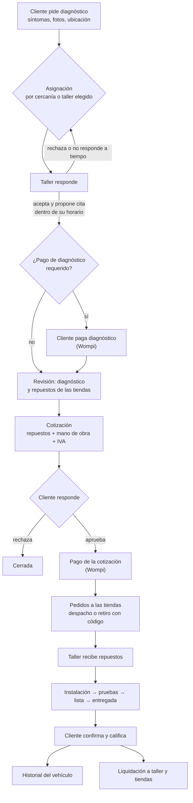
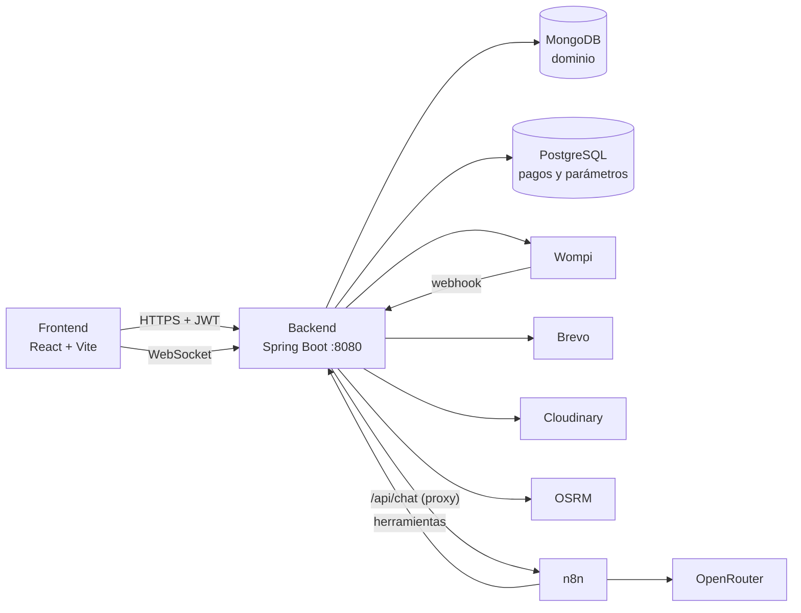

# DriveMaster

Marketplace que conecta a **dueños de vehículos**, **talleres mecánicos** y **tiendas de autopartes**. El cliente
pide un diagnóstico, un taller cercano lo revisa, cotiza con repuestos que tienen en stock las tiendas, el cliente
paga en línea y sigue la reparación hasta la entrega. Cada servicio queda en el historial del vehículo.

Proyecto de aula de Tecnología en Desarrollo de Software.

**Integrantes:** Brainy Blanco · Sebastian Ortega · Juan Cantillo · Elias Puello

---

## Contenido

- [El problema](#el-problema)
- [Cómo funciona](#cómo-funciona)
- [Roles](#roles)
- [Capturas](#capturas)
- [Tecnologías](#tecnologías)
- [Arquitectura](#arquitectura)
- [Estructura del repositorio](#estructura-del-repositorio)
- [Cómo levantarlo](#cómo-levantarlo)
- [Datos de demostración](#datos-de-demostración)
- [Pruebas](#pruebas)
- [Tablas paginadas](#tablas-paginadas)
- [Despliegue](#despliegue)
- [Limitaciones de esta versión](#limitaciones-de-esta-versión)

---

## El problema

- **El cliente** no sabe qué tiene su carro, a qué taller llevarlo ni cuánto le va a costar, y desconfía de los
  presupuestos.
- **El taller** pierde tiempo consiguiendo repuestos y clientes nuevos.
- **La tienda de autopartes** vende solo a quien llega al mostrador.

DriveMaster junta a los tres en un mismo flujo: el diagnóstico lo hace un taller cercano, la cotización usa
repuestos reales con precio y stock de las tiendas, y el cliente aprueba y paga antes de que se toque el vehículo.
La plataforma cobra una comisión por servicio (parámetro `COMISION_PCT`) y los negocios pueden tener un plan de
suscripción.

## Cómo funciona

1. **Solicitud.** El cliente registra su vehículo y pide un diagnóstico: síntomas, fotos y ubicación. Puede elegir
   un taller en el mapa o dejar que la plataforma lo asigne por cercanía (ruta real con OSRM, radio
   `RADIO_MAX_KM`).
2. **Respuesta del taller.** El taller tiene un plazo para responder (`TIMEOUT_TALLER_MIN`). Si acepta, propone la
   cita dentro de su horario de atención. Si rechaza o no responde, la solicitud pasa sola al siguiente taller.
3. **Pago del diagnóstico (opcional).** Si `PAGO_DIAGNOSTICO_REQUERIDO` está activo, el cliente paga la tarifa de
   diagnóstico con Wompi antes de la cita.
4. **Diagnóstico.** El mecánico registra hallazgos, fallas, urgencia y fotos, y elige los repuestos entre los
   productos de las tiendas cercanas, confirmando la compatibilidad con el vehículo.
5. **Cotización.** El taller cotiza repuestos y mano de obra (por ítem o por horas, con IVA y vigencia). Un
   predictor avisa si el precio se sale de lo esperado. El cliente la recibe en la app y por correo.
6. **Aprobación y pago.** El cliente aprueba o rechaza. Si aprueba, paga con Wompi.
7. **Repuestos.** Se generan los pedidos a cada tienda; la tienda prepara y despacha, o deja el pedido listo para
   retirar con un código de retiro. El taller confirma que los recibió.
8. **Reparación.** Instalación, pruebas (opcional), lista y entregada. El cliente recibe un correo en cada hito.
9. **Cierre.** El cliente confirma la recepción y califica al taller. El servicio queda en el historial del vehículo.
10. **Liquidación.** El pago se reparte entre el taller, las tiendas y la comisión de la plataforma.



Además del flujo de servicio, el cliente puede comprar repuestos directamente en el **catálogo** de las tiendas
(compra con envío o retiro).

## Roles

| Rol | Qué hace |
| --- | --- |
| **CLIENTE** | Registra sus vehículos, pide diagnósticos, aprueba y paga cotizaciones, compra en el catálogo, califica al taller y consulta su historial. |
| **TALLER** | Responde solicitudes, agenda citas según su horario, diagnostica, cotiza, gestiona el trabajo hasta la entrega, administra sus mecánicos y ve sus informes. |
| **TIENDA** | Publica productos con stock, prepara y despacha pedidos, valida códigos de retiro y lleva su inventario, compras y proveedores. |
| **ADMIN** | Operación diaria: aprueba o rechaza talleres y tiendas, sigue los servicios y resuelve problemas de envío. |
| **SUPERADMIN** | Todo lo anterior más usuarios, parámetros de la plataforma (comisión, tarifas, plazos), planes y liquidaciones. |

Talleres y tiendas se registran desde la app y quedan pendientes hasta que un administrador los aprueba.

## Capturas

Guarda las imágenes en `docs/capturas/` con estos nombres y agrégalas aquí con
``:

| Archivo | Qué mostrar |
| --- | --- |
| `landing.png` | Página de inicio |
| `solicitar-diagnostico.png` | Cliente: solicitud con el mapa de talleres |
| `taller-inicio.png` | Taller: resumen del día |
| `taller-agenda.png` | Taller: agenda en calendario |
| `cotizacion.png` | Cotización con repuestos de tiendas |
| `tienda-pedidos.png` | Tienda: pedidos por despachar |
| `movil.png` | Vista en celular |

## Tecnologías

### Backend (`drivemaster/`)

| Tecnología | Uso |
| --- | --- |
| Java 21 + Spring Boot 3.4.5 | API REST y tareas programadas |
| Spring Security + JWT (jjwt) | Autenticación sin sesión, roles y refresh token |
| Google API Client + OAuth2 | Inicio de sesión con Google |
| Spring Data MongoDB | Dominio principal: usuarios, talleres, tiendas, productos, órdenes, cotizaciones, pedidos |
| Spring Data JPA + PostgreSQL | Pagos, repartos, reembolsos, suscripciones y parámetros de la plataforma |
| Spring WebSocket | Notificaciones en tiempo real (campanita) |
| RestTemplate (Spring Web) | Llamadas a servicios externos (Wompi, Brevo, OSRM, n8n) |
| Bucket4j + Caffeine | Límite de peticiones por IP y caché |
| OpenPDF + Apache POI | PDF y Excel de reportes |
| Cloudinary | Imágenes de productos, vehículos, diagnósticos y logos |
| Lombok | Menos código repetido en entidades y DTOs |
| JUnit 5 + Mockito + Spring Security Test | Pruebas |

### Frontend (`frontend/`)

| Tecnología | Uso |
| --- | --- |
| React 19 + Vite 8 | SPA |
| Leaflet + React Leaflet + Supercluster | Mapas de talleres (OpenStreetMap), agrupación de pines |
| CSS propio con tokens | Sistema de diseño (`src/css/ui.css`, `src/components/ui/`), tema claro y oscuro |
| ESLint | Estilo y reglas de hooks |
| `node --test` | Pruebas |

Sin librerías de componentes, de íconos ni de fechas: los íconos son SVG propios (`components/public/Icon.jsx`) y
el calendario de la agenda está hecho a mano.

### Servicios externos

| Servicio | Uso |
| --- | --- |
| Wompi (sandbox) | Pagos con tarjeta: diagnóstico, cotizaciones y catálogo |
| Brevo | Correos transaccionales |
| n8n + OpenRouter | Asistente de chat de la tienda (agente con herramientas que consultan el catálogo) |
| OSRM, Photon, Nominatim | Rutas en carro, búsqueda de direcciones y dirección de un punto del mapa |
| MongoDB Atlas, Supabase (PostgreSQL) | Bases de datos administradas |

## Arquitectura



- **Capas:** `controller` (HTTP y permisos) → `service` (reglas de negocio) → `repository` (datos). Las respuestas
  salen siempre como DTO, con vistas distintas para cliente, taller y administrador.
- **Estados de una orden:** `EstadoOrden` define qué actor puede pasar de qué estado a cuál, y
  `TransicionOrdenService` aplica cada cambio de forma atómica y lo registra en la línea de tiempo.
- **Seguridad:** permisos por rol y método en `SecurityConfig` (cada módulo termina en `denyAll`), y cada servicio
  verifica que el recurso sea del usuario de la sesión. El webhook de Wompi no confía en el cuerpo: consulta la
  transacción en la API de Wompi.
- **Tareas programadas:** reasignación de solicitudes vencidas, despachos atrasados, confirmación automática de
  recepción, recordatorios de mantenimiento y resumen semanal de las tiendas.

## Estructura del repositorio

```
├── drivemaster/                 Backend Spring Boot
│   ├── src/main/java/.../       controller, service, repository, model, dto, security, config, scheduler, util, websocket
│   ├── src/test/java/...        Pruebas
│   └── MIGRACIONES_PENDIENTES.md  Cambios de datos que se hacen a mano
├── frontend/                    SPA React
│   ├── src/pages/               Pantallas por rol (taller/, tienda/, admin/)
│   ├── src/components/          ui/ (sistema de diseño), servicio/, mapa/, marketplace/, chat/
│   ├── src/services/            Cliente HTTP por módulo
│   └── tests/                   Pruebas (node --test)
├── ml/                          Generación del dataset y entrenamiento del predictor de precios
├── n8n/                         Workflow del asistente de chat y su guía
├── homelab/                     Despliegue propio (Proxmox + Docker + Cloudflare Tunnel)
├── docker-compose.yml           Backend + frontend + n8n
└── .env.example                 Referencia de variables de entorno
```

## Cómo levantarlo

### Requisitos

- JDK 21 (el proyecto trae Maven Wrapper: `./mvnw`)
- Node.js 20 o superior
- Una base MongoDB y una PostgreSQL (Atlas y Supabase sirven en su plan gratuito)
- Opcional según lo que quieras probar: cuentas de Wompi sandbox, Brevo, Cloudinary y Google OAuth

### 1. Variables de entorno

```bash
cp .env.example .env
```

Completa `.env`; cada variable está explicada en el propio `.env.example`. Para arrancar, como mínimo:

| Variable | Para qué |
| --- | --- |
| `SPRING_DATA_MONGODB_URI` | Conexión a MongoDB |
| `DB_URL`, `DB_USERNAME`, `DB_PASSWORD` | Conexión a PostgreSQL (`jdbc:postgresql://…`) |
| `SECURITY_JWT_SECRET` | Firma de los tokens (mínimo 32 caracteres aleatorios) |
| `FRONTEND_URL` | URL del frontend (CORS y redirecciones) |
| `VITE_API_URL` | URL del backend que usa el frontend (por defecto `http://localhost:8080`) |

Sin `BREVO_API_KEY` no se envían correos; con `MAIL_DEV_LOG=true` el asunto y el destinatario de cada correo salen
en el log. Sin las llaves de Wompi no se puede pagar (ver `PAGO_SIMULADO_ENABLED` más abajo).

### 2. Backend

```bash
cd drivemaster
./mvnw spring-boot:run          # Windows: .\mvnw.cmd spring-boot:run
```

La API queda en `http://localhost:8080/api/...`. Al arrancar se crean los parámetros de la plataforma en PostgreSQL
y los índices de MongoDB.

### 3. Frontend

```bash
cd frontend
npm install
npm run dev
```

Abre `http://localhost:5173`.

### 4. Todo junto con Docker

```bash
docker compose up --build
```

Levanta el backend (`:8080`), el frontend con nginx (`:80`) y n8n (`:5678`) con su base de memoria del chat. Las
bases de datos principales siguen siendo las de tu `.env`.

### Primer administrador

Ningún proceso crea un SUPERADMIN automáticamente. Regístrate como usuario normal y cambia el rol en MongoDB:

```js
db.usuarios.updateOne({ correo: "tu-correo@ejemplo.com" }, { $set: { rol: "SUPERADMIN" } })
```

El personal entra por el acceso interno de la app.

## Datos de demostración

Con `DEMO_SEED_ENABLED=true` el backend crea al arrancar (si no existen):

- Cliente `cliente.demo@drivemaster.com` / `Demo1234*`, con 4 vehículos.
- Talleres `automax@drivemaster.com`, `expressmotor@drivemaster.com` y `tallercentral@drivemaster.com`, con
  contraseña `Taller1234*`.
- Repuestos compatibles con stock para el vehículo principal del cliente demo.

Otras banderas útiles solo en desarrollo o demostración (apagadas por defecto):

| Variable | Efecto |
| --- | --- |
| `PAGO_SIMULADO_ENABLED=true` | Botón para aprobar un pago sin pasar por Wompi. Solo funciona con llaves de prueba (`pub_test_`). |
| `PAGO_VERIFICACION_MANUAL_ENABLED=true` | "Ya pagué, verificar mi pago" consulta la transacción en Wompi si el webhook no llega. |
| `MAIL_DEV_LOG=true` / `MAIL_DEV_SKIP_SEND=true` | Registrar los correos en el log / no enviarlos. |

Son contraseñas conocidas: no actives `DEMO_SEED_ENABLED` en un despliegue público.

## Pruebas

**Backend** (JUnit 5 y Mockito; no necesitan bases de datos):

```bash
cd drivemaster
./mvnw test   # todas; DrivemasterApplicationTests queda omitida
```

`DrivemasterApplicationTests` levanta el contexto completo: se conecta a las bases, corre las migraciones del
arranque y deja activas las tareas programadas (que mandan correos). Solo corre con `DRIVEMASTER_IT=true` y las
variables de unas bases **de prueba**, nunca las de producción:

```bash
DRIVEMASTER_IT=true SPRING_DATA_MONGODB_URI=... DB_URL=jdbc:postgresql://... DB_USERNAME=... DB_PASSWORD=... \n  ./mvnw test -Dtest=DrivemasterApplicationTests
```

Incluyen reglas de negocio (cotizaciones, liquidación, horario, historial), permisos por rol con la configuración
de seguridad real (`PermisosEndpointsTest`, `AislamientoTiendasWebTest`, …) y las tareas programadas.

**Frontend:**

```bash
cd frontend
npm test        # lógica de las pantallas (node --test)
npm run lint
```

## Tablas paginadas

Las tablas grandes se paginan, filtran y ordenan en el servidor, con un formato común
(`dto.comun.Pagina`: `items`, `total`, `pagina` desde 0, `tamano` y `totalPaginas`).

- **Parámetros:** `page` (desde 0), `size` (20 por defecto, máximo 100), `sort=campo,asc|desc` (cada tabla tiene su
  lista blanca: otro campo responde 400) y, donde hay fecha, `desde` y `hasta` (AAAA-MM-DD, hora de Colombia;
  `hasta` incluye todo ese día).
- **Tienda** (endpoints aparte; las listas completas siguen para selectores y formularios):
  `/api/productos/mi-tienda/tabla`, `/api/pedidos-tienda/mios/tabla` y `/api/movimientos/tabla`.
- **SUPERADMIN:** `/api/plataforma/pedidos`, `/productos`, `/clientes`, `/usuarios` y `/api/liquidaciones/repartos/tabla`.

### Alias por quitar después de la feria

Nombres de parámetros de antes que se siguen aceptando mientras se termina la migración. Para quitarlos, borra el
parámetro y pasa `null` en su lugar a `PeticionTabla.de(...)` o `RangoFechas.de(...)`:

| Alias | Reemplazo | Dónde |
|---|---|---|
| `pagina`, `tamano` | `page`, `size` | `PlataformaController`: `/pedidos`, `/productos`, `/clientes` y `/usuarios` |
| `fechaInicio`, `fechaFin` | `desde`, `hasta` | `TablasTiendaController`: `/api/movimientos/tabla` |
| `atrasados=true` | `alerta=ATRASADO` | `PlataformaController`: `/pedidos` |

`/api/movimientos` (la lista completa, sin paginar) sigue con `fechaInicio`/`fechaFin` porque no cambió.

## Despliegue

- **Frontend:** Vercel (`frontend/vercel.json` redirige todas las rutas a la SPA).
- **Backend:** Render con `drivemaster/Dockerfile` (puerto 8080). En el plan gratuito el servicio se duerme tras un
  rato sin uso y tarda cerca de un minuto en despertar; el frontend espera 20 s por respuesta y ofrece reintentar.
- **Bases de datos:** MongoDB Atlas y Supabase.
- **HomeLab:** alternativa propia con Proxmox, Docker y Cloudflare Tunnel; ver [`homelab/README.md`](homelab/README.md).
- **Chat:** importar el workflow de [`n8n/`](n8n/README.md) y crear ahí la credencial de OpenRouter.

## Limitaciones de esta versión

- **Predictor de precios con datos sintéticos.** El modelo que avisa si una cotización se sale de lo esperado se
  entrenó con un dataset generado por nosotros (`ml/generar_dataset.py`), no con cotizaciones reales. Sirve para
  demostrar la integración; sus cifras no deben tomarse como referencia de mercado. El backend usa los pesos del
  modelo (`modelo_pesos.json`) directamente en Java; el servicio en Python de `ml/` es opcional.
- **Dispersión de pagos simulada.** La liquidación calcula lo que le corresponde a cada taller y tienda, pero en
  esta versión el envío del dinero es simulado o se marca a mano (`DISPERSION_MODO`); no hay transferencias reales.
- **Pagos en sandbox.** Wompi está configurado con llaves de prueba.
- **Dos flujos de servicio.** Conviven el flujo actual (marketplace) y las órdenes del flujo anterior, que solo se
  consultan y se cierran ("Órdenes anteriores").
