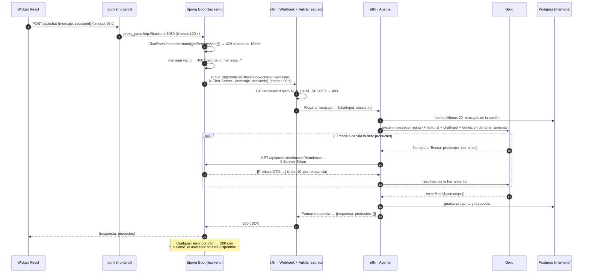

# Chatbot de DriveMaster: cómo funciona (n8n en el stack de Portainer)

Funcionamiento del chat IA de punta a punta: el widget de React, el proxy de Spring Boot, el workflow de
n8n y su despliegue en el stack `drivemaster` de Portainer (`homelab/docker-compose.yml`). Al final están
los [problemas que se encontraron y cómo se resolvieron](#8-problemas-encontrados-y-cómo-se-resolvieron).

> Última revisión: 2026-10-11. Describe el código **después** de las correcciones.

---

## 1. Resumen

- El usuario escribe en un widget flotante de React. El widget hace `POST /api/chat` al backend con
  `{ mensaje, sessionId }`, sin JWT: el chat es anónimo.
- Spring Boot **no tiene lógica de IA**: limita a 15 mensajes por minuto por IP (la IP real, resuelta por
  Tomcat), valida que el mensaje no venga vacío y lo reenvía al webhook de n8n con el header
  `X-Chat-Secret`.
- n8n valida el secreto y ejecuta un **AI Agent** con Groq (`openai/gpt-oss-120b`), memoria en Postgres
  (Supabase) por `sessionId` y una herramienta, `Buscar productos`, que consulta
  `GET /api/productos/buscar` con el header `X-Service-Token`.
- n8n responde `{ respuesta, productos: [] }`. El backend lo pasa tal cual al widget, que muestra
  `respuesta`.
- En Portainer, n8n es un servicio más del stack: comparte la red interna con el backend (`http://n8n:5678`
  y `http://backend:8080`), publica el 5678 **solo en `127.0.0.1` de la VM** (editor por túnel SSH) y
  guarda workflows, credenciales, ejecuciones y su clave de cifrado en el volumen `drivemaster_n8n_data`.

---

## 2. Arquitectura

### 2.1 Dónde vive cada pieza en el stack de Portainer

```
Internet ─HTTPS─► Tailscale Funnel / Cloudflare Tunnel
                         │
                         ▼
              ┌──────────────────── VM (Proxmox) · stack "drivemaster" en Portainer ──────────────────┐
              │                                                                                        │
              │  frontend (nginx :80, publicado en :8088)                                              │
              │     ├── /        → React compilado (incluye el ChatWidget)                             │
              │     └── /api/... → backend:8080 ──┐                                                    │
              │                                   ▼                                                    │
              │  backend (Spring Boot :8080, sin puerto publicado)                                     │
              │     POST /api/chat ──X-Chat-Secret──► n8n:5678/webhook/chat-drivemaster                │
              │     GET  /api/productos/buscar ◄──X-Service-Token── (herramienta del agente)           │
              │                                   │                                                    │
              │  n8n (:5678, publicado SOLO en 127.0.0.1 de la VM → túnel SSH)                         │
              │     volumen drivemaster_n8n_data: workflows, credenciales, ejecuciones, clave de cifrado│
              └───────────────────────────────────┬────────────────────────────────────────────────────┘
                                                  │
                         ┌────────────────────────┼────────────────────────┐
                         ▼                        ▼                        ▼
                  Groq API               Supabase (Postgres)        MongoDB Atlas
                  (credencial en n8n)    tabla drivemaster_chat_    (productos que lee
                                         memory (credencial en n8n)  el backend)
```

| Servicio | Imagen / build | Puertos | Red interna | Persistencia |
| --- | --- | --- | --- | --- |
| `frontend` | `homelab/frontend.Dockerfile` (React + `nginx.conf`) | `${LAN_PORT:-8088}:80` | `frontend` | — |
| `backend` | `drivemaster/Dockerfile` (`pull_policy: build`) | ninguno | `backend:8080` | Atlas + Supabase (nube) |
| `n8n` | `docker.n8n.io/n8nio/n8n:${N8N_VERSION:-latest}` | `127.0.0.1:5678:5678` | `n8n:5678` | volumen `drivemaster_n8n_data` |
| `cloudflared` | `cloudflare/cloudflared:latest` | ninguno | — | — |

Nombres que crea Portainer con el proyecto `drivemaster`: contenedores `drivemaster-backend-1`,
`drivemaster-n8n-1`, `drivemaster-frontend-1`; red `drivemaster_default`; volumen `drivemaster_n8n_data`.

### 2.2 Recorrido de un mensaje



---

## 3. Componentes en detalle

### 3.1 Frontend: widget de chat

Archivos: [`frontend/src/components/chat/`](../frontend/src/components/chat/)

| Archivo | Qué hace |
| --- | --- |
| [`ChatWidget.jsx`](../frontend/src/components/chat/ChatWidget.jsx) | Botón flotante con tres estados (`closed`, `open`, `minimized`). Es dueño de la conversación vía `useChat`, porque está siempre montado. |
| [`useChat.js`](../frontend/src/components/chat/useChat.js) | Mensajes, envío, timeout de 95 s, mensajes de error (incluido el 429), "Nueva conversación". |
| [`chatSesion.js`](../frontend/src/components/chat/chatSesion.js) | `sessionId` y mensajes en `localStorage`; `reiniciarChat()`. |
| [`ChatWindow.jsx`](../frontend/src/components/chat/ChatWindow.jsx) | Ventana: cabecera (nueva conversación, minimizar, cerrar), mensajes y campo de texto. |
| [`ChatInput.jsx`](../frontend/src/components/chat/ChatInput.jsx) | `textarea`: Enter envía y Shift+Enter hace salto de línea. |
| [`MessageBubble.jsx`](../frontend/src/components/chat/MessageBubble.jsx) | Texto plano con `white-space: pre-wrap` (respeta párrafos y listas). |

- Se monta una vez en [`App.jsx`](../frontend/src/App.jsx), así que aparece en **todas** las páginas.
- **`sessionId`**: UUID en `localStorage['dm-chat-session']`. Por la LAN (HTTP, sin `crypto.randomUUID`)
  usa 16 bytes de `crypto.getRandomValues`.
- **Mensajes**: los últimos 50, en `localStorage['dm-chat-mensajes']`. Minimizar, cerrar o recargar
  mantiene la conversación, igual que la memoria de n8n.
- **Nueva conversación / logout**: `reiniciarChat()` borra ambas claves y avisa al widget con el evento
  `chat:reiniciar`. El siguiente mensaje crea otro `sessionId`, así que el agente empieza sin memoria.
  `handleLogout` lo llama para que en un equipo compartido nadie herede la conversación anterior.
- **Llamada**: `fetch` a `${VITE_API_URL}/api/chat`, sin JWT. En el HomeLab, `VITE_API_URL` es
  `PUBLIC_URL`: mismo dominio, nginx lo reenvía y no hay CORS.

### 3.2 Backend: proxy hacia n8n

| Archivo | Rol |
| --- | --- |
| [`ChatProxyController.java`](../drivemaster/src/main/java/com/drivemaster/drivemaster/controller/ChatProxyController.java) | `POST /api/chat`: valida, limita y reenvía a n8n |
| [`ChatRateLimiter.java`](../drivemaster/src/main/java/com/drivemaster/drivemaster/security/ChatRateLimiter.java) | Bucket4j + Caffeine: N mensajes por minuto por IP, en memoria |
| [`ChatRequest.java`](../drivemaster/src/main/java/com/drivemaster/drivemaster/dto/ChatRequest.java) / [`ChatResponse.java`](../drivemaster/src/main/java/com/drivemaster/drivemaster/dto/ChatResponse.java) | Contrato `{mensaje, sessionId}` → `{respuesta, productos}` |
| [`SecurityConfig.java`](../drivemaster/src/main/java/com/drivemaster/drivemaster/security/SecurityConfig.java) | `/api/chat/**` y `GET /api/productos/buscar` son `permitAll` (la herramienta valida su token aparte) |
| [`application.properties`](../drivemaster/src/main/resources/application.properties) | Propiedades `n8n.*` y `server.forward-headers-strategy=native` |

Flujo de `ChatProxyController.chat()`:

1. IP del cliente = `http.getRemoteAddr()`. Con `forward-headers-strategy=native`, Tomcat
   (RemoteIpValve) ya recorrió `X-Forwarded-For` desde la derecha saltando los proxies internos (nginx,
   cloudflared), así que es la IP real y el cliente no puede falsificarla.
2. `chatRateLimiter.consumir(ip)` → `429` en JSON (`{"error": "Has enviado demasiados mensajes..."}`).
3. Mensaje vacío → `400`.
4. Arma `{mensaje, sessionId}` (`"anon-" + ip` si no viene `sessionId`) y agrega `X-Chat-Secret`.
5. Llama al webhook (conexión 5 s, lectura 90 s) y devuelve `respuesta` (o `output`) y `productos`.
6. Cualquier excepción → `200` con "Lo siento, el asistente no está disponible…" y en el log
   `Error llamando a n8n (<url>): <mensaje>`. El mensaje incluye el código HTTP si n8n respondió, por
   ejemplo `403 Forbidden`.

| Propiedad | Variable de entorno | Por defecto | En el stack de Portainer |
| --- | --- | --- | --- |
| `n8n.webhook.url` | `N8N_WEBHOOK_URL` | `http://localhost:5678/webhook/chat-drivemaster` | `http://n8n:5678/webhook/chat-drivemaster` |
| `n8n.chat.secret` | `N8N_CHAT_SECRET` | vacío | **obligatoria** |
| `n8n.tools.secret` | `N8N_TOOLS_SECRET` | vacío → la herramienta responde 403 | **obligatoria** |
| `n8n.chat.rate.max-por-minuto` | `N8N_CHAT_RATE_MAX` | `15` | variable opcional del stack |

### 3.3 Herramienta del agente: `GET /api/productos/buscar`

[`ProductoController.buscarParaChat`](../drivemaster/src/main/java/com/drivemaster/drivemaster/controller/ProductoController.java)
→ [`ProductoServiceImpl.buscarParaAgente`](../drivemaster/src/main/java/com/drivemaster/drivemaster/service/ProductoServiceImpl.java)

- **Token**: exige `X-Service-Token == n8n.tools.secret`, comparado en tiempo constante. Si el secreto no
  está configurado, responde `403` siempre (antes, en ese caso, el endpoint quedaba abierto).
- **Términos**: `terminos=pastillas,freno,mazda` → minúsculas, sin vacíos, de 2 o más caracteres, sin
  palabras vacías (`de`, `para`, `con`…), sin duplicados, máximo 10. Cada término se **escapa** antes de
  usarlo como `$regex`, así que `c++` o `(` ya no rompen la consulta de Mongo.
- **Consulta** ([`ProductoRepository.searchByTerm`](../drivemaster/src/main/java/com/drivemaster/drivemaster/repository/ProductoRepository.java)):
  busca sin distinguir mayúsculas en `nombre`, `categoria`, `marca`, `modelosCompatibles.marca` y
  `modelosCompatibles.modelo`.
- **Alcance**: solo productos activos de **tiendas visibles**, el mismo criterio que el catálogo público.
- **Relevancia**: se ordena por cuántos términos coinciden con cada producto y se devuelven 10.
- **Respuesta** (`ProductoDTO`): `id, codigo, nombre, categoria, marca, precioVenta, stockActual,
  imagenUrl, tipo, diasEntregaEncargo, compatibilidadUniversal, modelosCompatibles, tienda`. Nunca
  incluye `precioCompra`, proveedor, ubicación ni stock mínimo.
- Tests: [`BuscarParaAgenteTest.java`](../drivemaster/src/test/java/com/drivemaster/drivemaster/service/BuscarParaAgenteTest.java).

### 3.4 Workflow de n8n: `DriveMaster - Chat tienda`

Archivo: [`workflows/chat-drivemaster.json`](workflows/chat-drivemaster.json) (se importa a mano).

```
Webhook chat ─► Validar secreto ─(sí)─► Preparar mensaje ─► Agente DriveMaster ─► Formar respuesta ─► Responder
                      └─(no)─► Rechazar (403)                 ▲      ▲      ▲
                                                ai_languageModel  ai_memory  ai_tool
                                                Modelo Groq     Memoria     Buscar productos
```

| Nodo | Tipo (versión) | Configuración clave |
| --- | --- | --- |
| **Webhook chat** | `webhook` (v2) | `POST /webhook/chat-drivemaster`, `responseMode: responseNode` |
| **Validar secreto** | `if` (v2) | `!!$env.N8N_CHAT_SECRET && headers['x-chat-secret'] === $env.N8N_CHAT_SECRET` |
| **Rechazar (403)** | `respondToWebhook` (v1.1) | `403 {"error": "No autorizado"}` |
| **Preparar mensaje** | `set` (v3.4) | `chatInput = body.mensaje`, `sessionId = body.sessionId \|\| 'anon'` |
| **Agente DriveMaster** | `agent` (v1.6) | *Prompt* = `{{ $json.chatInput }}`; reglas en *System Message* |
| **Modelo Groq** | `lmChatGroq` (v1) | `model = {{ $env.GROQ_MODEL \|\| 'openai/gpt-oss-120b' }}`, temperatura 0.3 |
| **Memoria (Postgres)** | `memoryPostgresChat` (v1.3) | Clave `{{ $('Preparar mensaje').item.json.sessionId }}`, tabla `drivemaster_chat_memory`, 20 mensajes |
| **Buscar productos** | `httpRequestTool` (v4.2) | `GET $env.N8N_TOOLS_BASE_URL/api/productos/buscar?terminos=$fromAI(...)` + `X-Service-Token: $env.N8N_TOOLS_SECRET` |
| **Formar respuesta** | `code` (v2, por ítem) | Devuelve **un objeto** `{ json: { respuesta, productos: [] } }` |
| **Responder** | `respondToWebhook` (v1.1) | Devuelve el JSON anterior |

Reglas del *System Message*:

1. Español, con un tono cercano.
2. Usar **siempre** la herramienta para productos, precios, stock y compatibilidad, sin inventar nada.
3. Enviar como términos el tipo de repuesto + marca/modelo del vehículo.
4. Confirmar la compatibilidad con `modelosCompatibles` y `compatibilidadUniversal`, o recomendar
   verificarla con la tienda o un taller.
5. Productos `ENCARGO`: no presentarlos como agotados; decir que se piden por encargo y cuántos días
   tardan. Mencionar la tienda que vende cada producto.
6. Ser honesto si no hay resultados.
7. Comparativas en máximo 3 párrafos.
8. Rechazar con amabilidad los temas fuera del negocio.
9. No pedir datos personales.
10. Escribir en texto plano, sin Markdown, con listas de guiones y precios en pesos colombianos.

### 3.5 Memoria conversacional

- La tabla `drivemaster_chat_memory` la crea sola el nodo, en la misma base de Supabase que usa el
  backend; `homelab/backup.sh` (pg_dump del esquema `public`) la respalda.
- La clave es el `sessionId` del navegador. El agente recuerda los últimos 20 mensajes de esa sesión.
- La tabla no se limpia sola (ver [pendientes](#9-pendientes)).

---

## 4. Configuración: qué va en cada sitio

| Dato | Dónde se define | Quién lo usa |
| --- | --- | --- |
| `N8N_CHAT_SECRET` | Variables del stack (obligatoria) → `backend` y `n8n` | Backend: header `X-Chat-Secret`. n8n: nodo `Validar secreto` |
| `N8N_TOOLS_SECRET` | Variables del stack (obligatoria) → `backend` y `n8n` | n8n: header `X-Service-Token`. Backend: lo valida |
| `N8N_TOOLS_BASE_URL` | Fijo en el compose: `http://backend:8080` | Herramienta `Buscar productos` |
| `GROQ_MODEL` | Variable opcional del stack | Nodo `Modelo Groq` |
| `N8N_VERSION` | Variable del stack: la versión que ya corre | Imagen de n8n |
| `N8N_BLOCK_ENV_ACCESS_IN_NODE=false` | Fijo en el compose | Permite `$env` en el workflow (n8n 2.x lo bloquea por defecto) |
| `N8N_CHAT_RATE_MAX` | Variable opcional del stack | Backend |
| `N8N_WEBHOOK_URL` | Variable opcional del stack | Backend |
| API key de Groq | **Credencial en n8n** | `Modelo Groq` |
| Conexión Postgres (Supabase) | **Credencial en n8n** | `Memoria (Postgres)` |
| Clave de cifrado de n8n | `/home/node/.n8n/config` en el volumen | Descifra las credenciales. Guárdala en tu gestor de contraseñas |

---

## 5. Contratos entre piezas

```http
POST /api/chat                                     (widget → backend)
Content-Type: application/json

{ "mensaje": "¿Tienen pastillas de freno para Mazda 3?", "sessionId": "2b9c…" }
```

```http
POST http://n8n:5678/webhook/chat-drivemaster      (backend → n8n)
Content-Type: application/json
X-Chat-Secret: <N8N_CHAT_SECRET>

{ "mensaje": "...", "sessionId": "2b9c…" }
```

```http
GET http://backend:8080/api/productos/buscar?terminos=pastillas,freno,mazda   (agente → herramienta)
X-Service-Token: <N8N_TOOLS_SECRET>
```

```json
[{ "id": "…", "codigo": "…", "nombre": "Pastillas de freno …", "categoria": "Frenos", "marca": "…",
   "precioVenta": 120000.0, "stockActual": 0, "imagenUrl": "https://…", "tipo": "ENCARGO",
   "diasEntregaEncargo": 3, "compatibilidadUniversal": false,
   "modelosCompatibles": [{ "marca": "Mazda", "modelo": "3", "anoDesde": 2014, "anoHasta": 2018, "motor": null }],
   "tienda": "Repuestos Norte" }]
```

```json
{ "respuesta": "Tenemos estas opciones…", "productos": [] }
```

Respuestas especiales del backend: `400` mensaje vacío, `429` límite de mensajes, `200` con "no está
disponible" ante cualquier fallo de n8n. n8n responde `403` sin el secreto correcto.

---

## 6. Tiempos de espera y límites

| Tramo | Valor |
| --- | --- |
| Widget → backend | 95 s (`AbortController`), luego "El asistente está tardando demasiado…" |
| Cloudflare Tunnel (cuando se use) | ~100 s por petición |
| nginx → backend | `proxy_read_timeout 120s` |
| Backend → n8n | conexión 5 s, lectura 90 s |
| Rate limit | 15 mensajes/min por IP (`N8N_CHAT_RATE_MAX`), en memoria |
| Búsqueda | máx. 10 términos y 10 productos |
| Memoria | últimos 20 mensajes por sesión; widget guarda los últimos 50 |

El backend corta primero (90 s) y su mensaje amable llega antes de que el widget (95 s), Cloudflare
(100 s) o nginx (120 s) corten la conexión.

---

## 7. Operación en Portainer

### 7.1 Desplegar o actualizar

1. Variables del stack: `N8N_CHAT_SECRET` y `N8N_TOOLS_SECRET` (obligatorias, `openssl rand -hex 32`) y
   `N8N_VERSION` con la versión de n8n que ya corre. **Pull and redeploy**.
2. Editor de n8n: `ssh -L 5678:localhost:5678 usuario@IP-VM` → `http://localhost:5678`.
3. Si había un workflow importado antes: desactívalo y bórralo. Importa `n8n/workflows/chat-drivemaster.json`.
4. Credenciales: *Groq* → `Modelo Groq`; *Postgres* (Supabase, Session pooler, SSL)
   → `Memoria (Postgres)`. El webhook no necesita credencial.
5. Activa el workflow.

### 7.2 Pruebas desde la VM

```bash
# n8n sin secreto: debe responder 403
curl -s -o /dev/null -w "%{http_code}\n" -X POST http://localhost:5678/webhook/chat-drivemaster \
  -H "Content-Type: application/json" -d '{"mensaje":"hola","sessionId":"x"}'
```

```bash
# Camino real del widget (nginx → backend → n8n): presentarse...
curl -s -X POST http://localhost:8088/api/chat -H "Content-Type: application/json" \
  -d '{"mensaje":"Hola, me llamo Ana","sessionId":"prueba-1"}'
```

```bash
# ...y comprobar que el agente recibe la pregunta y recuerda: debe responder "Ana"
curl -s -X POST http://localhost:8088/api/chat -H "Content-Type: application/json" \
  -d '{"mensaje":"¿Cómo me llamo?","sessionId":"prueba-1"}'
```

```bash
# Herramienta: con el token correcto devuelve productos; sin él, 403
curl -s -H "X-Service-Token: TU_N8N_TOOLS_SECRET" "http://localhost:8088/api/productos/buscar?terminos=freno"
```

### 7.3 Dónde mirar cuando falla

| Síntoma | Dónde mirar | Causa probable |
| --- | --- | --- |
| El stack no se despliega: *Define N8N_CHAT_SECRET…* | Portainer | Faltan los secretos obligatorios |
| Widget: "el asistente no está disponible" | Logs de `drivemaster-backend-1` → `Error llamando a n8n` | `404`: workflow inactivo · `403`: secreto distinto · `500`: falla un nodo (ver Executions) · timeout |
| Widget: "Has enviado demasiados mensajes…" | — | Límite de 15/min por IP |
| Nunca encuentra productos | n8n → Executions → `Buscar productos` | `403` por `N8N_TOOLS_SECRET` distinto, o `$env` bloqueado (falta `N8N_BLOCK_ENV_ACCESS_IN_NODE=false`) |
| Error del modelo (*model not found / decommissioned*) | n8n → Executions → `Modelo Groq` | `GROQ_MODEL` retirado por Groq: elige otro con soporte de herramientas |
| Falla la memoria | n8n → Executions → `Memoria (Postgres)` | Credencial sin asignar o Supabase inaccesible (usar Session pooler) |

### 7.4 Cambiar el workflow sin perderlo

Edita en el editor y prueba con `/webhook-test/chat-drivemaster`. Luego **Download** y reemplaza
`n8n/workflows/chat-drivemaster.json` en el repo, para que el repositorio siga siendo la fuente de verdad.

---

## 8. Problemas encontrados y cómo se resolvieron

| # | Gravedad | Problema | Solución | Archivos |
| --- | --- | --- | --- | --- |
| 1 | 🔴 | **El modelo nunca recibía la pregunta del usuario.** El nodo agente tenía las reglas en *Prompt (User Message)* (`text`) y ninguna referencia a `chatInput`: el modelo recibía siempre el mismo texto de reglas. | *Prompt* = `{{ $json.chatInput }}` y reglas en *Options → System Message*. | `chat-drivemaster.json` |
| 2 | 🔴 | **El secreto del webhook no se aplicaba.** El nodo Webhook pedía *Header Auth*, que necesita una credencial; el bloque `headerAuth` escrito en el JSON n8n lo ignora. El webhook fallaba o, si alguien quitaba la autenticación, quedaba abierto. | Webhook sin credencial + nodo **Validar secreto** (IF) que compara `X-Chat-Secret` con `$env.N8N_CHAT_SECRET` y responde 403 si no coincide (o si la variable está vacía). Funciona al importar, sin pasos manuales. | `chat-drivemaster.json` |
| 3 | 🔴 | **"Formar respuesta" devolvía un array en modo "por ítem".** En ese modo, n8n exige un objeto y falla con *Code doesn't return a single object*. | Devuelve `{ json: { respuesta, productos } }`. | `chat-drivemaster.json` |
| 4 | 🔴 | **El modelo configurado se ignoraba.** El nodo de Gemini usaba el parámetro `model`, pero el nodo lee `modelName`; quedaba el modelo por defecto del nodo, que puede estar retirado. | `modelName: models/{{ $env.GEMINI_MODEL \|\| 'gemini-2.5-flash' }}`, `typeVersion: 1`. | `chat-drivemaster.json` |
| 5 | 🟠 | **`$env` bloqueado en n8n 2.x e imagen sin versión.** `latest` puede saltar de versión mayor en un redeploy, y desde n8n 2.0 `$env` falla por defecto (secreto, URL y modelo). | `N8N_BLOCK_ENV_ACCESS_IN_NODE=false` e imagen `n8n:${N8N_VERSION:-latest}` en ambos compose. | `homelab/docker-compose.yml`, `docker-compose.yml`, `homelab/.env.example` |
| 6 | 🟠 | **Herramienta HTTP antigua.** `toolHttpRequest` es el *HTTP Request Tool* obsoleto. | Nodo **HTTP Request** como herramienta (`httpRequestTool` v4.2) con `$fromAI` y descripción manual. | `chat-drivemaster.json` |
| 7 | 🟡 | **Memoria con clave ambigua.** `sessionKey: "sessionId"` dependía del modo por defecto; en modo *Define below* todos compartirían una sola memoria. | `sessionIdType: customKey` + `sessionKey: {{ $('Preparar mensaje').item.json.sessionId }}`. | `chat-drivemaster.json` |
| 8 | 🟡 | **El bot ofrecía productos de tiendas ocultas** (pausadas, sin aprobar o sin datos completos) que el cliente no puede comprar. | Filtro por tiendas visibles, igual que `listarCatalogoPublico`. | `ProductoServiceImpl.java` |
| 9 | 🟡 | **Búsqueda pobre:** no miraba la compatibilidad; el OR de términos se cortaba en 10 sin ordenar; los productos `ENCARGO` con stock 0 parecían agotados; un `(` en el término rompía Mongo. | Búsqueda en `modelosCompatibles.marca/modelo`, orden por términos coincidentes, palabras vacías descartadas, términos escapados; DTO con `tipo`, `diasEntregaEncargo`, compatibilidad y `tienda`; reglas nuevas en el prompt. Tests nuevos. | `ProductoRepository.java`, `ProductoServiceImpl.java`, `ProductoService.java`, `ProductoDTO.java`, `ProductoController.java`, `BuscarParaAgenteTest.java` |
| 10 | 🟡 | **Rate limit evadible:** se tomaba el primer valor de `X-Forwarded-For`, que lo escribe el cliente. | `http.getRemoteAddr()`, que Tomcat ya resuelve con los proxies de confianza. | `ChatProxyController.java` |
| 11 | 🟡 | **Token de la herramienta que fallaba abierto:** con `N8N_TOOLS_SECRET` vacío no se validaba nada, y el endpoint está publicado vía nginx. Compose con secretos por defecto conocidos. | Sin secreto → 403 siempre; comparación en tiempo constante; en el HomeLab los dos secretos son obligatorios (`${VAR:?…}`). | `ProductoController.java`, `homelab/docker-compose.yml` |
| 12 | 🟡 | **`N8N_CHAT_RATE_MAX` no llegaba al backend** en el HomeLab. | Agregada al `environment` del backend. | `homelab/docker-compose.yml` |
| 13 | 🟡 | **Minimizar o cerrar el chat borraba la conversación** (ChatWindow se desmonta) y perdía la respuesta en curso; al recargar, el bot recordaba cosas que el usuario ya no veía. | Estado en el hook `useChat` dentro de `ChatWidget` (siempre montado) + mensajes persistidos en `localStorage`. | `useChat.js`, `chatSesion.js`, `ChatWidget.jsx`, `ChatWindow.jsx` |
| 14 | 🟡 | **Memoria compartida entre usuarios:** el `sessionId` sobrevivía al logout. Además, por HTTP (LAN) el id era `Date.now()`, que puede repetirse. | Botón **Nueva conversación**, reinicio en el logout e id aleatorio con `getRandomValues`. | `chatSesion.js`, `ChatWindow.jsx`, `App.jsx` |
| 15 | 🟢 | **Detalles del widget:** el 429 se mostraba como "hubo un error"; la respuesta se demoraba 800 ms a propósito; sin timeout; saltos de línea y Markdown mal mostrados. | Muestra el motivo del 429/400, sin espera artificial, timeout de 95 s, `white-space: pre-wrap` y el prompt pide texto plano. | `useChat.js`, `chat.css`, `chat-drivemaster.json` |
| 16 | 🟢 | **Guías desactualizadas:** la prueba usaba `localhost:8080` (no publicado en el HomeLab) y faltaban pasos y variables. | `n8n/README.md`, `homelab/README.md` y `.env.example` actualizados. | docs |
| 17 | 🔴 | **Cuota de Gemini agotada.** Google retiró `gemini-2.5-flash` para cuentas nuevas y el plan gratuito de su reemplazo permite 20 llamadas al día (cada mensaje del chat gasta 2 o más). | El modelo pasa a **Groq** (nodo `lmChatGroq`, `GROQ_MODEL`, por defecto `openai/gpt-oss-120b`). | `chat-drivemaster.json`, compose, `.env.example`, guías |

### Verificación hecha

- Workflow: el JSON es válido, todas las conexiones apuntan a nodos existentes y el código de *Formar
  respuesta* se ejecutó con y sin `output`.
- Frontend: `eslint` sin errores, `npm run build` correcto, `npm test` 7/7. En el navegador: enviar un
  mensaje (sin backend aparece el mensaje de error), minimizar y volver, recargar y "Nueva conversación".
- Backend: **no se compiló ni se ejecutaron los tests** en el equipo donde se hicieron los cambios (no hay
  JDK 21 ni Docker). Hay que correr `./mvnw test` antes de desplegar.
- Workflow en n8n real: falta importarlo y hacer las pruebas de la [sección 7.2](#72-pruebas-desde-la-vm).

---

## 9. Pendientes

- **Clave de cifrado de n8n**: guardar el valor de `/home/node/.n8n/config` en el gestor de contraseñas.
  Si algún día se fija `N8N_ENCRYPTION_KEY`, debe ser **ese mismo** valor.
- **Retención**: n8n guarda cada ejecución con el mensaje del usuario y `drivemaster_chat_memory` crece
  sin límite. Valorar `EXECUTIONS_DATA_MAX_AGE` corto y una limpieza periódica de la tabla.
- **Funnel**: comprobar qué IP ve el backend detrás de Tailscale Funnel. Si todos los clientes llegan con
  la misma IP, comparten el cupo de 15/min.
- **`productos`**: el widget podría mostrar tarjetas de producto si *Formar respuesta* armara el array con
  los datos de la herramienta.
- **Más herramientas**: estado de orden de servicio, talleres activos, agendar cita.
